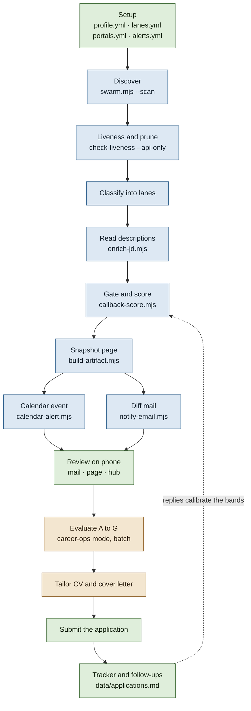
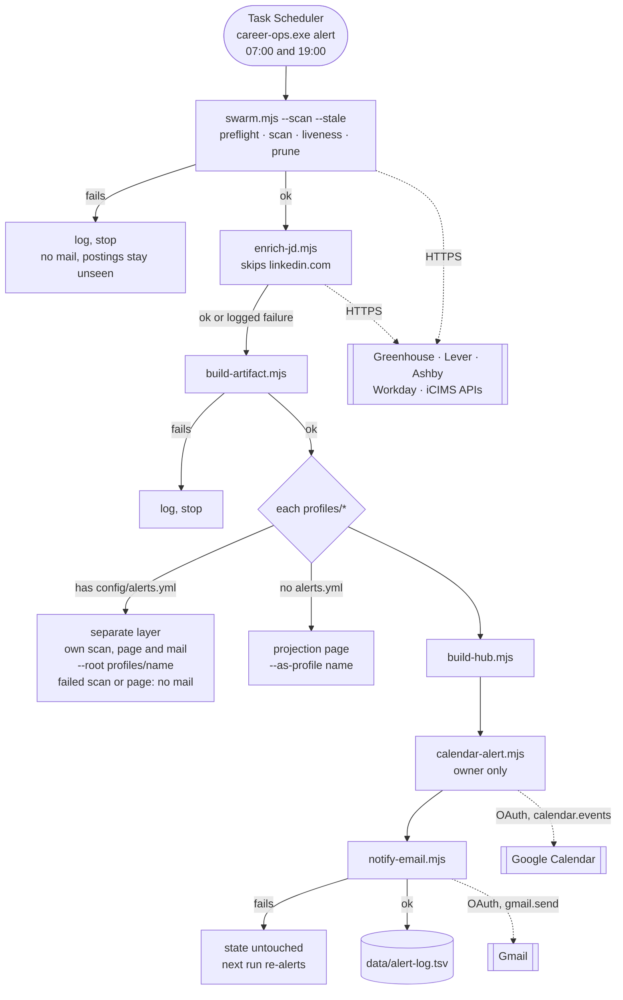
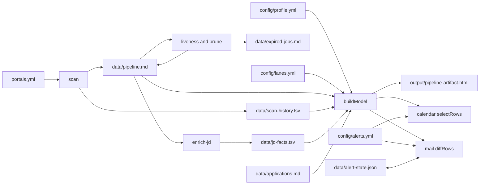
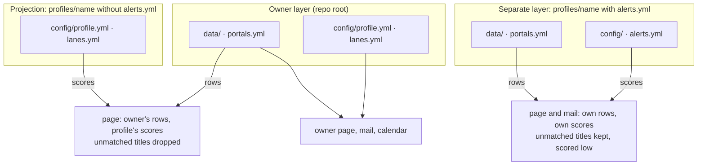

# End to end: workflow, system, surfaces, and the definition of done

This document maps career-ops from first setup to a submitted application. For
each stage it says what "done" means and which check proves it. Those checks run
against a synthetic persona instead of the two profiles the system was tuned
on, so a rule that quietly reads one person's values shows up as a failure
rather than as a page that looks right to its author.

```bash
node --test tests/persona-e2e.test.mjs tests/persona-run.test.mjs \n  tests/persona-property.test.mjs tests/runner.test.mjs
```

The persona lives in `tests/fixtures/personas/general/`. It contains config and
data only: no code path knows it exists.

## The problem space

A job seeker wants the few postings worth an application today and the reason
each one made the cut. They do not want to read five hundred listings, and they
do not want anything submitted for them. "Done" for the system means:

- a new person can describe their targeting in config alone;
- every posting that reaches them was found, is still live, fits that targeting,
  and carries its reasons;
- every posting that was held back names the rule that held it back;
- nothing they see describes someone else's targeting.

## Personas

### The general persona

Riley Moreno is synthetic. Riley is a data and backend engineer with about four
years of experience, based in Chicago, who wants hybrid work in Chicago or a
remote US role. Riley holds a bachelor's degree and no clearance, and needs no
visa. Riley's floor is $140K, and Riley skips roles that ask for more than six
years. Riley reads the mail on a phone in the morning and wants a calendar block
at 18:30 Central for the best match of the day.

Every scoring key in Riley's profile differs from the maintainer profiles: role
family, home metro, region rule, years ceiling, comp floor, time zone, and no
hats model.

### Persona axes

| Axis | Owner profile | Second profile | Riley (general) | New grad (not built) | EU (not built) |
|---|---|---|---|---|---|
| Role family | UI/UX, front end, forward deployed | embedded, firmware | data, backend | software engineer | backend |
| Home metro | Southern California to Bay Area | California | Chicago | anywhere in the US | Berlin |
| Clearance | held | held | none | none | n/a |
| Sector bonus | none | government | none | none | none |
| Hats model | on | off | off | off | off |
| Years ceiling | none | set | 6 | 1 | none |
| Work authorization | citizen | citizen | citizen | needs sponsorship | needs a permit |
| Floor currency | USD | USD | USD | USD | EUR |
| Checked by | live data | live data | `persona-e2e`, `persona-run` | nothing yet | nothing yet |

The two unbuilt columns mark axes the system has no rule for yet. See
[Open findings](#open-findings).

`persona-property` covers the space between the columns. It generates 200
profiles from a fixed seed (one or two primary roles, home metro or none,
degree, years ceiling, clearance, sector, frameworks, hats on or off, comp
floor) and runs each over one generated corpus. In the corpus, rows come in
groups that share company, location, date and description facts and differ only
in title. For every profile it checks that each score is finite and between 0
and 100, that a gated row scores 0, that a profile without hats never sees the
hats model, that the core lane names the profile's own roles, that within a
group a stronger title family never scores below a weaker one, and that a
projection drops exactly the unmatched titles. A failure message carries the
seed, the profile index and the profile itself.

## Workflow: who does each step

Blue steps run unattended on a schedule. Amber steps call a model. Green steps
are the person's.



The line between blue and green is the product's main promise. Everything above
"Review" is deterministic and never acts on the person's behalf. Everything
below it either asks a model or waits for the person.

## System: one scheduled run

`career-ops.exe alert` runs at 07:00 and 19:00. The exe is a windowless
launcher for `node runner.mjs alert`; the chain itself, and every rule below,
lives in `runner.mjs`. A failed scan or page build stops the chain before the
mail, because a mail sent after a failed scan would mark a
day of postings as seen. Every other failure is logged and the chain continues.



A weekly sweep, `career-ops.exe sweep` on Sunday at 03:00, is the only path that
finds companies missing from `portals.yml`. It is off this diagram because
nothing it does changes the morning mail.

## Running without a session

The scheduled runs need no Claude session. `node runner.mjs install` compiles
`career-ops.exe` from `scripts/launcher.cs` and registers the alert and sweep
tasks on it; `--sync` adds the ten-minute cloud sync. The exe passes its
arguments to `node runner.mjs` and appends the output to
`data/runner-log.txt`. It decides nothing, so a change to the chain is a change
to `runner.mjs` and takes effect on the next run without a rebuild.

`career-ops.exe` with no arguments writes and opens `output/status.html`: each
task's last result and next run, the last twenty rows of `data/alert-log.tsv`,
and links to the pages that exist. When a row says FAILED, the page tells the
person to paste it, or the log, into the session that maintains the install.
Diagnosis and fixes happen there; the installed copy only runs.

## Data: which files each stage reads and writes



`buildModel` in `build-artifact.mjs` is the single join. The page, the calendar
step and the mail all select from the rows it returns, so a posting cannot score
one way on the page and another way in the mail.

## Profile layers

The intent files (`config/profile.yml` and `config/lanes.yml`) decide how rows
are scored. The data files decide which rows exist. A profile under `profiles/`
uses one of two modes, and the mode depends on whether it has its own
`config/alerts.yml`.



The persona fixture has its own `alerts.yml`, so the scheduler would run it as a
separate layer. The test builds it that way, and builds it a second time as a
projection to check that unmatched titles are dropped.

## Surfaces: what the person sees, and where

| Surface | Produced by | When | Readable on a phone |
|---|---|---|---|
| Mail body: top rows by match, new and upgraded | `notify-email.mjs` | after each run with a change | yes, static inline HTML |
| Mail attachment: the whole page | `build-artifact.mjs` | same mail | opens in a browser |
| Calendar event: one per posting over the stricter bar | `calendar-alert.mjs` | slot time in the profile's zone | yes |
| Pipeline page: rows, scores, reasons, gates, funnel | `build-artifact.mjs` | each run | yes, when published as an artifact |
| Hub: links to every profile's page | `build-hub.mjs` | each run | yes |
| Web app: board, pipeline, apply, CV studio, follow-ups | `web/` (Next.js) | on demand, local | no, it runs on localhost |
| Interview invite file | `ics-interview` | on demand | yes |

## Definition of done, stage by stage

| Stage | Done when | Check | Covered for Riley |
|---|---|---|---|
| Setup | A new person configures targeting by editing config only | the fixture is config and data only | yes |
| Discover | Postings that match `title_filter.positive` reach `pipeline.md` | scan and provider tests | no, needs the network |
| Liveness | A closed posting leaves the pipeline and is logged | liveness and prune tests | no, needs the network |
| Classify | Each row lands in the lane its title keyword names | `classify` | yes |
| Read | Description facts land in `jd-facts.tsv` | `persona-run` read: the real parser over the fixture's cached descriptions reproduces its facts | yes |
| Gate | Each profile-owned rule stops its row and names itself | `gate` | yes |
| Segment | Locations bucket by the profile's own home metro | `segment` | yes |
| Rank | A fresh home-metro primary role outranks above-level and remote | `rank` | yes |
| Project | Titles outside the target roles score low, or drop under a projection | `project` | yes |
| Page | Nothing on the page describes another person's targeting | `page` | yes |
| Mail | A first run reports every ungated row over the floor | `mail` | yes |
| Over time | Each run mails only new rows and rows that rose into a top band; an unchanged day sends nothing | `persona-run` days | yes |
| Calendar | Stricter bar, profile's own zone, no LinkedIn | `calendar` | yes |
| Thresholds | Every floor in the profile's `alerts.yml` can be reached | `thresholds` | yes |
| Orchestrate | The scheduled chain runs its stages in order, stops on the failures that would mark postings seen unmailed, and logs the rest | `runner` | yes |
| Any profile | Scoring and page invariants hold for generated profiles | `persona-property` | 200 generated |
| Evaluate | A to G report with a 1 to 5 fit score | `evals/golden` | no, needs a model |
| Apply | A human submits; nothing is sent automatically | apply-runner tests | no |
| Track | The tracker row joins back to its posting | artifact-build tests | not for Riley |

## Findings from the first run

Three single-user assumptions were fixed in the same change that added the
persona:

- The `core` lane label read "AI / front-end / forward-deployed" on every
  profile's page. It now names the profile's own `target_roles.primary`.
- The scoring footer and the signal table described the three-hats model to
  profiles that never turned it on. Both now follow `scoring.hats`.
- The funnel label "Match ≥ 42" was a second copy of the strong band's floor.
  It now reads the floor from `BANDS`.

## Findings from the packaging pass

- A separate layer whose page build failed was still mailed, with the previous
  run's page attached. `alert.cmd` never checked that exit code. The runner
  now skips that layer's mail and logs the failure.
- The scheduled tasks were registered with Task Scheduler's default of not
  starting on battery, so a laptop unplugged at 07:00 skipped the run without
  a log row. `runner.mjs install` registers them to run on battery.
- Running on battery is not the same as waking on battery. On the first night
  after the cutover the laptop was unplugged and closed at 15:02. Wake timers
  are off on battery, so 19:00 passed in standby. At 07:02 it left standby for
  four seconds on its way to hibernate. Start-when-available launched one run
  for both missed slots in that window, and the process froze with the machine
  and finished after the lid opened at 08:12. Task Scheduler still recorded the
  launch as refused (0x800710E0). The mail was late, but nothing was lost,
  because the alert diffs against the last one it sent. A catch-up task was
  built and then parked: it would only help when a frozen run is killed by a
  shutdown, and the next slot covers that.
- Liveness recorded nothing on the 10-29 19:00 and 10-30 07:00 runs, and no
  row said so. `check-liveness.mjs` exits 1 both for its normal report and for
  a crash, and `swarm.mjs` read both as a report. It now checks for the
  `Results:` line and exits 3 without one, which the alert logs as
  `liveness FAILED - continuing`; the sweep checks the same line. The same look showed the cost of that stage:
  about 3,300 pending LinkedIn URLs at 3.5 s each kept the 10-31 mail waiting
  more than three hours. The daily run now skips LinkedIn in liveness, and the
  weekly sweep checks those URLs.
- The fixture's facts were hand written, and one of them (a bachelor's degree)
  is a value the parser cannot produce. The facts are now the parser's own
  output over cached description text, and `persona-run` checks that they stay
  so.

## Open findings

1. **Score ceiling for profiles without hats.** When a profile has no hats
   model, the title family is the whole fit, capped at 0.62 for a primary
   title. With no framework, clearance or sector bonus, the best possible score
   is 62. A calendar floor of 65 therefore selects nothing for Riley, and gives
   no warning. Reading the description can lower these scores, through a gate,
   but can never raise them. The fix is a decision about the cap: lifting it for
   rows whose description was read would rescale the second profile's scores,
   and its floors would need retuning.
2. **The calendar step uses one Google account.** The alert chain runs
   `calendar-alert.mjs` for the owner only, so the `alerts.calendar` block in a
   separate layer never runs. Running it would place that person's events on
   the owner's calendar. The two candidate shapes are an attendee invite to the
   layer's `alerts.to` address, or a token per layer.
3. **The default time zone is the owner's.** `alerts.calendar.time_zone`
   defaults to `America/Los_Angeles`. Riley's config sets
   `America/Chicago`, and without that line the event would land at 18:30
   Pacific.
4. **No work-authorization fact.** `enrich-jd` extracts no sponsorship or
   authorization terms, so a person who needs sponsorship gets no gate on
   postings that rule it out. Kappa's cached description says it cannot
   sponsor a visa; nothing in its facts records that.
5. **The floor has no currency.** `parseMoney` ignores the currency, so a EUR
   floor is compared with whatever number the description states.
6. **No way to say "no degree".** `scoring.degree` names the highest degree
   held, and the rule is off when it is absent. The parser files a bachelor's
   requirement as `open`, so a person without a degree cannot be gated or
   discounted on postings that require one.
7. **The years floor is the lowest figure outside a PhD branch.** "10+ years of
   experience, or 5+ years with a master's" reads as 5. This is deliberate,
   because the parser does not know which branch applies to the person, but it
   means a years ceiling never gates a posting that names any lower figure.
